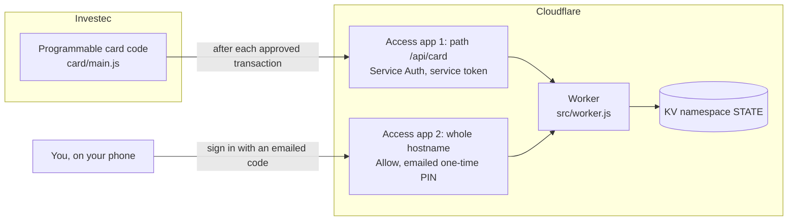

# Investec Card Spend Tracker

Track your **Investec Programmable Card** spending by category on your own phone-friendly web app, hosted on **Cloudflare Workers** and protected by **Cloudflare Access** (sign in with an emailed one-time code).

Every approved card transaction is reported to your own Worker, which files it under **eating out**, **holiday** or **clothing** (or ignores it). You can also log cash spend by hand, and fix any purchase that was filed in the wrong place.

> **Tracking only.** The card code **never declines a transaction.** Nothing here can block a purchase at a till.
>
> **Unofficial.** This is a community project. It is not made, endorsed or supported by Investec or Cloudflare. See the [disclaimer](#disclaimer).

---

## What you get

- **Automatic allocation.** Card spend is sorted into eating out, holiday or clothing by merchant category code, with your own **merchant rules** layered on top (for example, "anything with `woolworths` in the name is clothing").
- **Eating-out budget.** A monthly budget where unspent money rolls into next month, a "weekend pot" for surplus, and named splurges you can check against what is left.
- **Accruing pots for holiday and clothing.** Each pot builds up by a monthly amount that never resets at year end, and is drawn down by once-off purchases. Change the monthly amount and past months keep what they earned.
- **Foreign-currency safety.** A purchase in another currency is held at R0 until you confirm what it cost in rand, so a EUR 840 hotel is never silently counted as R840.
- **One-tap corrections.** Move any entry between categories, and turn a correction into a permanent rule.
- **No third parties.** The page loads nothing from outside your own Worker. No analytics, no fonts, no CDN.
- **Tested.** A security suite that forges tokens, plus allocation, card-code, UI and deploy-script tests, all runnable offline with `npm test`.

## How it fits together



1. You pay with your card. Investec runs your card code, which **approves the transaction and then reports it** (merchant code, merchant name, amount, currency).
2. The report goes to your Worker through a Cloudflare Access "service token" door, and is checked again with a shared secret.
3. The Worker decides which ledger it belongs to and stores it in Cloudflare KV in **your** account.
4. You open the web app, sign in with a code sent to your email, and see where you stand.

More detail in [docs/01-overview.md](docs/01-overview.md).

## What you need

| You need | Notes |
| --- | --- |
| An Investec account with a **programmable card** | Enrol for Investec Developer in Investec Online. See [Investec's developer site](https://developer.investec.com/). |
| A free **Cloudflare account** | No domain required: your app lives at `https://<name>.<your-subdomain>.workers.dev`. |
| **Cloudflare Zero Trust** (free plan) | Provides Access. Cloudflare asks for payment details to activate it even on the free plan; the free plan is not charged. |
| **Node.js 22 or newer** | Wrangler 4 (Cloudflare's CLI) requires it. |
| **Python 3.7 or newer** *(optional)* | Only for the command-line deploy script. You can paste code into Investec's IDE instead. |

Cloudflare's free tiers are comfortable for one household's spending. Check Cloudflare's current limits and pricing yourself before relying on that.

## Quick start

The full, click-by-click guides are in [`docs/`](docs/). The short version:

1. **Get the code and install:** `git clone <this repo>`, then `npm install`. ([guide](docs/02-cloudflare-account-and-worker.md))
2. **Create a Cloudflare account** and log in: `npx wrangler login`.
3. **Create the storage:** `npx wrangler kv namespace create STATE`, then paste the id into `wrangler.toml`.
4. **Deploy:** `npx wrangler deploy`. Until you finish step 5 the app refuses to show anything, by design.
5. **Set up Cloudflare Access** (team, one-time PIN login, an app for people, a service token and an app for the card) and set four Worker secrets. ([guide](docs/03-cloudflare-access.md))
6. **Put the card code on your card** with the IDE or the deploy script, and fill in `env.json`. ([guide](docs/04-investec-card.md))
7. **Simulate a transaction**, then make a small real purchase.

Budget about an hour the first time, most of it in the Cloudflare Access setup.

## Repository layout

```
src/worker.js          The Worker: web app, API, allocation logic, token checks
card/main.js           The Investec card code (paste into the Programmable Card IDE)
card/env.example.json  Template for the card's environment variables
scripts/               Python 3.7+ tools: a deploy/simulate/logs CLI for the card, and a
                       pre-publish scanner for secrets and personal identifiers
test/                  JavaScript and Python tests (npm test)
docs/                  Step-by-step guides, security notes, API reference
wrangler.toml          Worker configuration (contains no secrets)
```

## What leaves your Investec account

After each approved transaction the card code sends your Worker exactly this, and nothing else:

| Field | Example |
| --- | --- |
| Merchant category code | `5812` |
| Merchant name | `Corner Cafe` |
| Amount | `125.5` |
| Currency | `zar` |
| A label you choose for the cardholder | `Sam` |

**Not sent:** card number, account number, card id, balance, or anything about your identity. Data is stored in Cloudflare KV in your own Cloudflare account. Read [docs/06-security.md](docs/06-security.md) for the full picture, including what Investec's own execution logs contain and how to share them safely.

## Security in one paragraph

People reach the app through Cloudflare Access with an emailed one-time code. The Worker **verifies the Access token itself** (signature, expiry, issuer, audience, and that it carries an email address) instead of trusting that Access is in front of it. The card uses a separate Access door (a service token) **and** a shared secret. Every secret lives in Cloudflare's secret store or Investec's environment variables, never in this repository. Details, threat model and what to do if something leaks: [docs/06-security.md](docs/06-security.md).

## Known limitations

- **Built for South Africa.** Amounts are rand and the day rolls over on South African time (UTC+2). Both are easy to change; see [docs/08-customising.md](docs/08-customising.md).
- **Merchant codes are approximate.** A hotel restaurant or a department store can be filed wrongly. That is what Move and merchant rules are for.
- **Foreign spend needs one tap.** Nothing in the card payload converts to rand, so you confirm the rand amount yourself.
- **One shared data blob.** State is a single JSON document in KV, written last-writer-wins. Two writes in the same instant can lose one. This is fine for one household and not a design for many users.
- **KV is eventually consistent.** After a change, another device can take up to a minute to see it.
- **Meant for personal use.** The `workers.dev` address suits hobby projects, per Cloudflare. A custom domain is an optional upgrade.

## Running the tests

```bash
npm install
npm test                                              # JavaScript: security, allocation, card code, UI
python -m unittest discover -s test -p "test_*.py"    # Python: the deploy script
```

No network access, accounts or credentials are needed to run them.

## Contributing and security reports

See [CONTRIBUTING.md](CONTRIBUTING.md). To report a vulnerability privately, see [SECURITY.md](SECURITY.md). **Never post secrets, tokens, account numbers or unmasked execution logs in an issue.**

## Disclaimer

This software is provided "as is", without warranty. It is not financial, tax or legal advice, and it is **not** a substitute for your bank statements. You are responsible for your own accounts, your own Cloudflare and Investec configuration, and for checking that what you build complies with the terms of the services you use, including Investec's programmable banking terms. Always test with the simulator before relying on it.

"Investec", "Cloudflare" and other names are trademarks of their respective owners and are used here only to describe what this project works with.

## License

[MIT](LICENSE)
