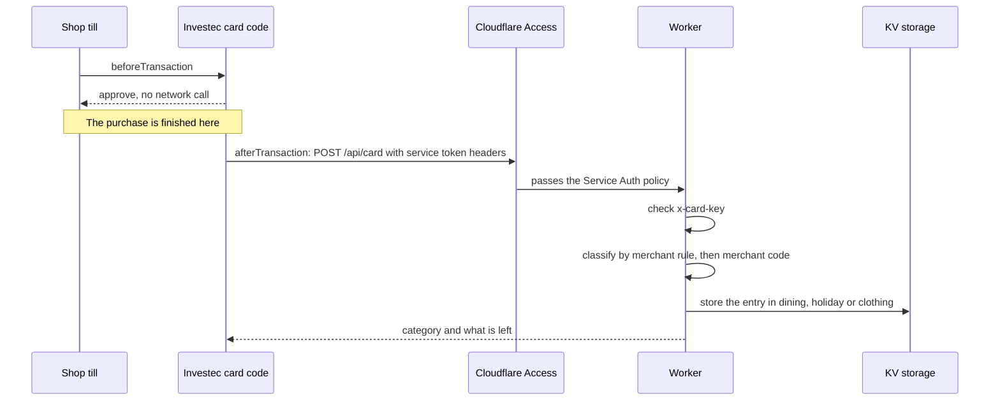
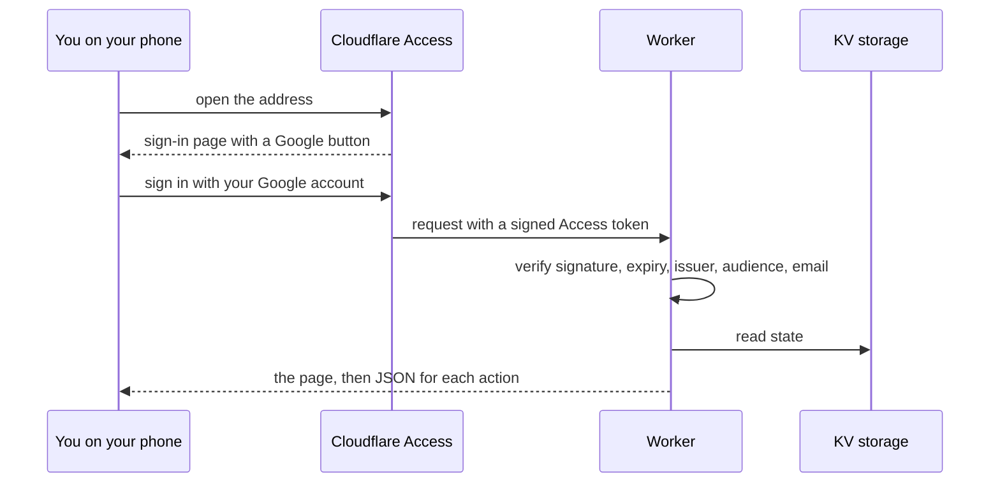

# 01. Overview and architecture

How the pieces fit together, why they are built this way, and what is stored where. Read this if you want to understand the system before installing it, or before changing it.

---

## The four parts

| Part | File | Runs on | Job |
| --- | --- | --- | --- |
| **Card code** | `card/main.js` | Investec's programmable card platform | Approve every transaction, then report it to the Worker. |
| **Worker** | `src/worker.js` | Cloudflare Workers | Serve the web app, decide which category each transaction belongs to, store the data. |
| **Cloudflare Access** | configured in the dashboard | Cloudflare | Keep strangers out of the app and the card endpoint. |
| **KV namespace `STATE`** | created with Wrangler | Cloudflare KV | Hold all of your data as one JSON document, plus daily snapshots. |

There is no server to maintain, no database to run and no build step. The Worker is one file with no runtime dependencies.

---

## What happens when you pay



Two properties matter:

1. **The purchase never waits on your infrastructure.** `beforeTransaction` approves immediately and makes no network call. Everything else happens after the transaction is already approved. If your Worker is down, Cloudflare is slow or your service token has expired, the purchase still goes through; only the recording is lost.
2. **The card code is deliberately dumb.** It reports raw facts and never decides which budget something belongs to. That decision lives in the Worker, so you can change your merchant rules or the category table without republishing code to your card.

---

## What happens when you open the app



The Worker does **not** assume that Access is in front of it. It verifies the signed token on every request to `/api/*`. See [06-security.md](06-security.md).

---

## The two Access applications

Cloudflare Access protects the Worker with two separate applications, because people and programs sign in differently:

- **App 1, people:** the whole hostname, policy **Allow** for specific emails, login with Google.
- **App 2, card:** only `/api/card`, policy **Service Auth** for one service token.

Cloudflare applies the most specific matching application first, so App 2 judges the card's requests and App 1 judges everything else. A service token has no email address and so can never sign in as a person, and a person's session cookie is not accepted on the card path. Step-by-step setup: [03-cloudflare-access.md](03-cloudflare-access.md).

---

## Data model

Everything is one JSON document stored under the KV key `dining-state`. (The name is historical: the project began as an eating-out tracker.)

```jsonc
{
  "settings": { "monthlyBudget": 3000, "carryDeficit": true },

  // Eating out. One object per month, keyed "YYYY-MM".
  "months": {
    "2026-10": {
      "budget": 3000,                 // this month's budget, kept as it was when set
      "stashed": 0,                   // surplus moved to the weekend pot
      "txns": [ /* entries, see below */ ]
    }
  },

  "goals": [ { "id": "…", "label": "Weekend away", "amount": 2500 } ],

  // Holiday and clothing. Each builds by a monthly rate and is drawn down by entries.
  "pots": {
    "holiday": {
      "rates":   [ { "from": "2026-01", "monthly": 2000 } ],
      "entries": [ /* entries, see below */ ]
    },
    "clothing": { "rates": [ ], "entries": [ ] }
  },

  // Merchant-name fragment -> category. Beats the merchant-code table.
  "rules": { "woolworths": "clothing" },

  "lastSnapshot": "2026-10-19"
}
```

### An entry

Entries in every ledger have the same shape:

```jsonc
{
  "id": "uuid",
  "date": "2026-10-19",          // South African date
  "name": "Corner Cafe",         // merchant name, trimmed to 60 characters
  "amount": 125.5,               // rand
  "by": "Sam",                   // label from the card, or the signed-in person's first name
  "src": "card",                 // "card" or "manual"
  "at": 1790000000000,           // when it was recorded (ms), used for duplicate detection
  "mcc": 5812,                   // card entries only
  "pending": true,               // foreign-currency card entries until you set the rand amount
  "foreign": { "currency": "EUR", "amount": 840.5 }
}
```

The signed-in person's name in `by` comes from the **verified token**, never from the browser, so it cannot be spoofed by a client.

### Snapshots

The first write each day also saves a copy of the whole document under `snap:YYYY-MM-DD`, which expires after 45 days. This is your safety net against a bad edit. See the backup commands in [02-cloudflare-account-and-worker.md](02-cloudflare-account-and-worker.md#backups).

### Limits

Caps exist so that a bug or an attacker cannot make the document grow without bound: 400 eating-out entries per month, 500 entries per pot, 30 goals, 50 merchant rules, 60 characters per name, and an 8 KB limit on any request body.

---

## Why these design choices

| Choice | Reason |
| --- | --- |
| **Allocation in the Worker, not the card** | You can change rules and tables instantly. Publishing card code goes through Investec and is slower and riskier. |
| **Tracking only, never declining** | A budget tool that can embarrass you at a till is a bad trade. The card code has no decline path at all, and a test asserts it. |
| **`beforeTransaction` makes no network call** | The authorization window is short. Nothing on the till's clock should depend on a third party. |
| **Foreign amounts held as pending** | The payload has a currency but no rand equivalent. Guessing would under-report holiday spend. |
| **One JSON document in KV** | Simple, portable and inspectable. The cost is last-writer-wins, which is fine for one household and not for many users. |
| **No third-party code or fonts** | The strict Content-Security-Policy forbids loading anything from outside. A test fails if the page ever references an external URL. |
| **Worker verifies the Access token itself** | A misconfigured Access policy should not mean open access. Missing configuration fails closed with a 503. |

---

## Where to look in the code

| You want to understand | Look at |
| --- | --- |
| Token checks | `verifyAccess` in `src/worker.js` |
| How a card transaction is routed | the `/api/card` handler, then `classify`, `findCardDupe`, `placeEntry` |
| The merchant-code table | `MCC_RANGES` |
| The monthly budget and carry-forward | `chain` |
| Pot accrual | `accrued` and `potView` |
| The page | the `PAGE` string near the bottom |

Every route is listed in [09-api-reference.md](09-api-reference.md).

---

## Next

[02. Create your Cloudflare account and deploy the Worker](02-cloudflare-account-and-worker.md)
